 

  <b>I design digital products that turn complex problems into simple, meaningful experiences.</b> 
  Product Designer (UI/UX) · Cairo &amp; Riyadh · Working remotely

  
  
  
  
  
  
  

---

### 👋 Hi, I'm Osama

I'm a product designer working on websites, SaaS platforms, mobile apps and e‑commerce stores — with a special focus on **Arabic RTL interfaces** and the **design systems** that keep big products consistent. I care about considered design that can actually be built, so my files are made to be handed off, not just admired.

### 🧭 How I think

| 01 · Understand | 02 · Simplify | 03 · Design systems | 04 · Experience |
| :-- | :-- | :-- | :-- |
| Start with the people, the problem and the business goal. | Strip the flow down to what really matters. | Turn decisions into tokens and components that scale. | Ship interfaces that feel calm, clear and consistent. |

### 🎨 What I design

- 🌐 **Websites & landing pages** — for agencies, software houses and real‑estate brands
- 📊 **SaaS platforms & dashboards** — complex data, simple screens
- 📱 **Mobile apps** — marketplaces, rentals and on‑demand delivery
- 🛍️ **E‑commerce stores** — Salla, Zid and Shopify
- 🔤 **Arabic RTL design systems** — bilingual products that feel native in both directions

### 💼 Experience

- **UI/UX Team Lead** — Serajj · Riyadh, Saudi Arabia
- **UI/UX Design Instructor** — DECI × EYouth · Egypt
- **UI/UX Designer (part‑time)** — Moharb · Egypt

### ✨ Selected work

| Project | What it is | |
| :-- | :-- | :-- |
| **Abha** | Real‑estate platform | [Case study →](https://www.behance.net/gallery/249086401/Abha-Real-Estate-Platform) |
| **Anan** | Beauty products e‑commerce store | [Case study →](https://www.behance.net/gallery/247795865/Anan-Beauty-Products-E-commerce-Store) |
| **Zawaad** | Car marketplace & rental app | [Case study →](https://www.behance.net/gallery/222843233/Zawaad-Car-Marketplace-Rental-App-Design) |
| **Naffiz** | Freelance marketplace platform | [Case study →](https://www.behance.net/gallery/221527659/Naffiz-Freelance-Marketplace-Platform-Design) |
| **BugXplore** | Cybersecurity platform | [Case study →](https://www.behance.net/gallery/222756061/BugXplore-Cybersecurity-Platform-Design) |
| **Halan Hala** | Grocery & meat delivery app | [Case study →](https://www.behance.net/gallery/222755955/Halan-Hala-Grocery-Meat-Delivery-App-Design) |

More on **[Behance](https://www.behance.net/osamaabdelnaser1)** and **[osama-abdelnaser.com](https://osama-abdelnaser.com)**.

### 🧰 Toolkit

**Design** &nbsp;

**Craft** &nbsp; Research · User flows · Wireframing · Prototyping · Design systems

**I also speak code** &nbsp;

### ☕ Off the clock

Photography · Chess · Languages · Voiceover · Reading · Writing · PlayStation · Coffee

---

  <b>Got a product that needs to feel simpler?</b> 
  <a href="https://osama-abdelnaser.com/contact">Send me a brief</a> · <a href="mailto:osamaabdelnaser18@gmail.com">osamaabdelnaser18@gmail.com</a>

